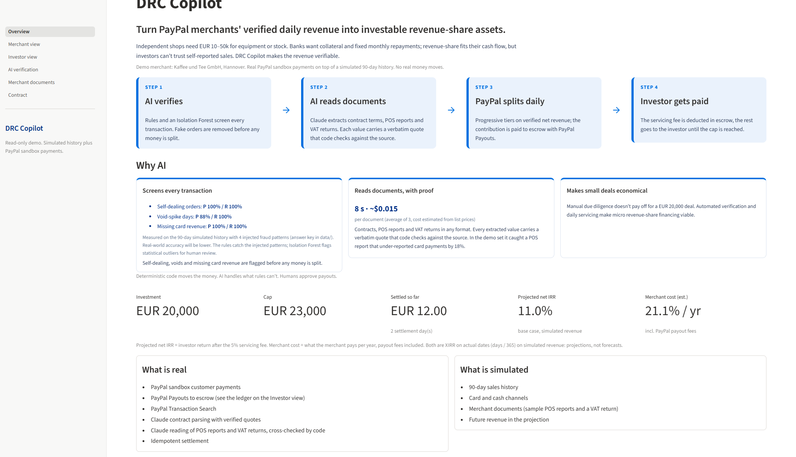
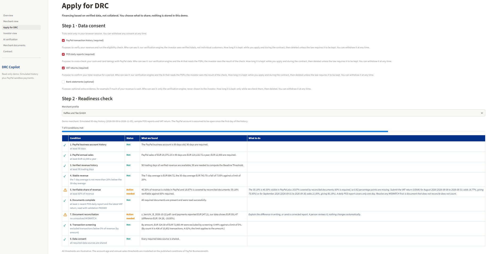
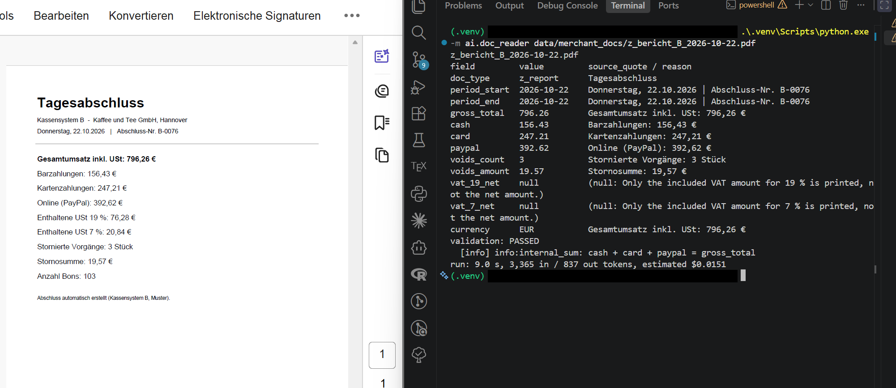
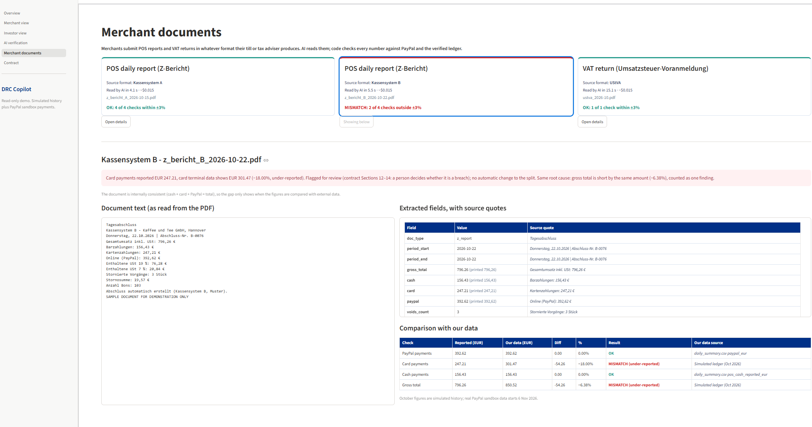
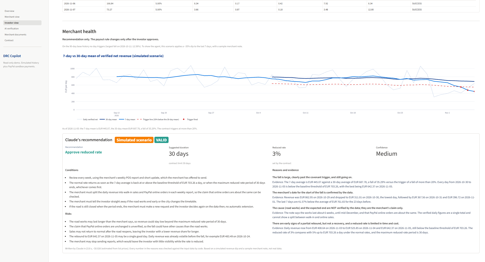

# DRC Copilot

**DRC Copilot turns PayPal merchants' verified daily revenue into investable revenue-share assets.**

Live demo: https://drc-copilot.onrender.com (Render free tier: the first load may take about a minute)



Built for the PayPal AI Hackathon 2026. DRC (Daily Revenue Contract) is the financing structure behind it: the merchant pays a small share of each day's verified revenue until a cap is reached; our contract for the demo merchant is the “Daily Revenue Contribution Agreement” (see the Contract page). Demo merchant: Kaffee und Tee GmbH, Hannover (EUR). All money moves in the PayPal sandbox.

## The problem

DRC Copilot is built for independent owner-run shops in Germany and the EU, such as a cafe, a tea shop or a small retailer, with a handful of employees and roughly EUR 250,000-350,000 in annual sales (estimated from the demo merchant's average daily revenue). Most of their takings already flow through PayPal and card terminals, so their sales history is digital and verifiable. These businesses regularly need EUR 10,000-50,000 for a new espresso machine, seasonal stock or a second location, but they fall into a financing gap:

- Bank loans often require collateral and a long credit history, and approval can take weeks.
- Fixed monthly repayments are hard to carry when sales swing between summer and winter.
- Equity financing means giving up ownership of a small family business.

A revenue-share agreement fits their cash flow: they repay a small percentage of each trading day's verified revenue, so repayments shrink in slow weeks, with no collateral and no ownership given up. The missing piece has always been trust on the investor side: a shop's sales are easy to inflate with fake orders or to hide in cash. DRC Copilot closes that gap. Its AI verifies each transaction before any money is split, so outside capital can fund merchants it could not otherwise assess.

## How it works

The demo contract: an investor funds EUR 20,000 on 2026-11-06. Each trading day the merchant pays 5% of verified net revenue up to EUR 703.26, and 3% above that, until EUR 23,000 (1.15x) has been paid or 24 months have passed. A 5% servicing fee is deducted in escrow; PayPal's payout fee is paid by the merchant on top.

0. **Merchant applies.** On the "Apply for DRC" page the merchant chooses which data to share: PayPal transaction history, POS daily reports and VAT returns are required, bank statements are optional. Code then checks nine conditions (PayPal account age and annual sales, verified revenue history, stable revenue, share of revenue that can be verified, complete documents, no unresolved MISMATCH between a document and our data, transaction screening, and data consent). Withdrawing a required consent turns the affected conditions into "needs consent". Claude then writes the next steps in plain English, one step per open condition, with what to prepare and roughly how long it takes. Code checks the advice, and the whole advice is marked **INVALID** (and shown as such) if:
   - a step refers to a condition id that does not exist, or to a condition that is already met;
   - a number or date in the text is not in the checklist data it was given (tolerance +-0.01);
   - the text uses an internal field name (a word with an underscore);
   - a time estimate is shorter than the earliest possible time the checklist gives (for example, an account that needs 45 more days cannot qualify in 10).

   If all nine conditions are met, code (not Claude) computes an indicative amount: 8% of annualised verified revenue, at most EUR 50,000. "Indicative only, not an offer. The investor makes the final decision." In the demo, Kaffee und Tee meets 7 of 9 (the verifiable share is 59.18% against 60%, and the Kassensystem B card mismatch is still open) and a sample bakery with 45 days of PayPal history meets 6 of 9. The page is read-only, calls no API and stores nothing.
   Code: `engine/eligibility.py`, `ai/eligibility_advisor.py`, thresholds in `data/eligibility_rules.json`.

   

1. **AI verifies.** Customer payments come in through PayPal and are read with Transaction Search. Rules plus an Isolation Forest screen every transaction; fake orders are removed before any money is split, odd-looking ones go to human review.
   Code: `paypal/reporting.py`, `ai/anomaly.py`.
2. **AI reads documents.** Claude reads the contract and the merchant's POS reports and VAT return, whatever their format. Every extracted value carries a verbatim quote that code checks against the source. Code then cross-checks the numbers against PayPal and the verified ledger.
   Code: `ai/contract_parser.py`, `ai/doc_reader.py`, `engine/reconcile.py`.
3. **PayPal splits daily.** Progressive tiers on verified net revenue; the contribution is paid to the escrow account with PayPal Payouts. The payout asks for a typed confirmation, is idempotent (`drc-{merchant}-{YYYYMMDD}`, a second run on the same day is refused) and is only booked as paid when PayPal reports `SUCCESS`.
   Code: `engine/split_engine.py`, `paypal/payouts.py`, `engine/ledger.py`.
4. **Investor gets paid.** In escrow the servicing fee comes off first and the rest is the investor's net return, until the cap is reached and the contract ends. The app shows gross and net IRR, the merchant's effective cost, three revenue scenarios, and a merchant health check that recommends (never decides) a temporary reduced rate.
   Code: `engine/irr_tracker.py`, `engine/health_agent.py`, `app/streamlit_app.py`.

## What is real, what is simulated

| Real | Simulated |
|---|---|
| PayPal sandbox customer payments | 90-day sales history |
| PayPal Payouts to escrow (see the ledger on the Investor view) | Card and cash channels |
| PayPal Transaction Search | Merchant documents (sample POS reports and a VAT return) |
| Claude contract parsing with verified quotes | Merchant health scenario (a simulated revenue dip plus a sample merchant note) |
| Claude reading of POS reports and VAT returns, cross-checked by code | Future revenue in the projection |
| Idempotent settlement | Merchant applications (consent ticks are not stored; Sample Bakery is a sample profile) |
| Eligibility rules and checks run as code on the same data as the rest of the demo; Claude’s next-step advice is generated by the Claude API and validated by code | |

## Where AI is used, and where it is not

### Merchant documents: two POS formats and a VAT return, read and cross-checked

Merchants send POS daily reports (Z-Bericht) and VAT returns (UStVA) in whatever layout their till or tax adviser produces. Our three sample documents deliberately look nothing alike: a table-style report from "Kassensystem A", a plain-text report from "Kassensystem B", and a UStVA form.

- **Claude reads them** with tool use into one schema (period, totals per payment channel, voids, VAT bases). Reading took 4.1 s, 5.5 s and 15.1 s; about 24.7 s and ~$0.046 for all three (estimated from list prices, from `data/demo/extracted.json`).
- **Every field carries a verbatim source quote.** Code rejects any value whose quote is not in the PDF; German number formats are parsed by code, not by the model.
- **Code cross-checks every number** (`engine/reconcile.py`, tolerance +-3%) against PayPal and the verified ledger. The Kassensystem A report and the UStVA match. **The Kassensystem B report states card payments of EUR 247.21 where the card terminal data shows EUR 301.47: under-reported by EUR 54.26 (-18.00%).** The gap in the gross total has the same root cause, so it is one finding, not two.
- **It only creates a review record.** Whether it is a breach of the contract (Sections 12-14) is a person's decision; the split is not changed automatically.





### Merchant health agent: code decides when, Claude writes the advice, code checks the advice

- **The trigger is deterministic code, no AI.** The 7-day mean of verified net revenue must fall more than the contract's 20% below the 30-day mean (thresholds are read from the parsed contract).
- **Claude only writes a recommendation** (approve the reduced rate of 3%, decline, or ask for more information; duration; conditions; reasons with evidence; risks; confidence) from the metrics, the last 30 days and a merchant's written note, which it treats as an unverified claim.
- **Code checks the answer.** Every number in the reasons must appear in the input (+-0.01), the duration must not exceed the contract's 30-day limit, and internal field names are rejected. A quoted number that is not in the input makes the whole recommendation INVALID, and the page says so.
- **It never changes anything.** The output is one JSON file; the payout rule changes only after the investor approves. The page has no buttons.
- **The scenario is simulated and labelled so.** On the 90-day base history no day triggers (largest fall: 12.58% on 2026-10-11). To show the agent, a scenario applies a -35% dip to the last 7 days, with a sample merchant note. On 2026-11-05 the 7-day mean is 35.29% below the 30-day mean; Claude recommended the reduced rate for at most 30 days with conditions (VALID, 23.8 s, ~$0.026).



### Contract parsing

Claude extracts 27 fields from the contract PDF (investment, tiers, cap, term, servicing fee, health covenant, reporting duties and more) in 23 s, ~$0.051. Each value has a verbatim quote that is checked against the PDF, and numeric rules are validated (for example, tiers ascend and the cap equals the multiple times the investment). The result is `data/contract_params.json`, which the split engine reads.

### Rules and Isolation Forest, honestly

Rules catch the fraud patterns we injected into the simulated 90 days: all injected self-dealing orders (436 of 436), deep price overrides (40 of 40), card revenue missing (3 of 3) and void-spike days (7 of 7), with some false alarms on the day-level detectors (for example evening-share drop: precision 70%). John and Peter GmbH's regular team orders (26) produced no false positive. This is measured against our own answer key, so real-world accuracy will be lower. The Isolation Forest does not decide anything: it flags statistical outliers, which stay in revenue and are listed "under review" for a person.

### Money is never moved by AI

The split, the payout, the ledger and the IRR maths are deterministic code with unit tests. A payout needs a typed confirmation and a person.

> **Deterministic code moves the money. AI handles what rules can't. Humans approve payouts.**

## Key results

- **2026-11-06, real sandbox settlement.** Four real buyer payments: EUR 166.84 verified net revenue. Contribution 5% = **EUR 8.34**, paid to escrow with PayPal Payouts (status `SUCCESS`). In escrow: servicing fee EUR 0.42, investor net **EUR 7.92**. The merchant paid PayPal's payout fee of EUR 0.17 on top.
- **2026-11-07, real sandbox settlement.** EUR 73.27 verified net revenue, contribution **EUR 3.66**, investor net EUR 3.48. Cumulative contributions: **EUR 12.00**.
- **Duplicate payout refused.** Running the settlement again for the same day is refused locally before PayPal is called (PayPal would reject the repeated batch ID as well).
- **Merchant documents.** The Kassensystem B report under-reported card payments by 18% (EUR 54.26); one review record, no automatic change.
- **Projection** (simulated revenue, XIRR on actual dates, from `data/demo/projection.json`):

| Scenario | Avg daily revenue | Net IRR (investor) | Net recovery multiple | Outcome |
|---|---|---|---|---|
| Base case | EUR 782.00 | 11.0% | 1.092x | cap reached 2028-07-23 |
| -20% revenue | EUR 625.00 | 6.7% | 1.066x | principal back 2028-09-20, cap not reached (EUR 561.45 short) |
| -40% revenue | EUR 468.75 | -18.3% | 0.812x | principal not recovered |

## Run it locally

Python 3.12.7 (see `.python-version`).

**Just the web app (no keys needed):**

```powershell
python -m venv .venv
.\.venv\Scripts\activate            # macOS/Linux: source .venv/bin/activate
pip install -r requirements-web.txt
streamlit run app/streamlit_app.py
```

The app only reads `data/demo/` and `data/contract_params.json`. It never calls PayPal or Claude.

**Everything else (PayPal sandbox and Claude):**

```powershell
pip install -r requirements.txt
Copy-Item .env.example .env         # macOS/Linux: cp .env.example .env
```

Fill in your own values in `.env`. The variable names are `PAYPAL_CLIENT_ID`, `PAYPAL_SECRET`, `PAYPAL_BASE_URL`, `MERCHANT_EMAIL`, `ESCROW_EMAIL`, `CONSUMER_A_EMAIL`, `CONSUMER_B_EMAIL`, `LLM_PROVIDER`, `ANTHROPIC_API_KEY` and `DEEPSEEK_API_KEY` (only the Anthropic provider is implemented). You need PayPal sandbox accounts for the merchant, escrow and buyers. `.env` is ignored by Git.

```powershell
python -m data.generate_data                    # 90 days of simulated history (fixed seed)
python -m ai.anomaly                            # screening -> verified revenue
python -m data.make_contract                    # sample contract PDF
python -m ai.contract_parser                    # Claude reads the contract
python -m data.make_merchant_docs               # sample POS reports and VAT return
python -m ai.doc_reader --all                   # Claude reads them
python -m engine.reconcile                      # code cross-checks them
python -m paypal.reporting --date 2026-11-06    # read real payments from Transaction Search
python -m engine.split_engine --date 2026-11-06 --dry-run   # without --dry-run: asks for YES, then pays (sandbox)
python -m engine.irr_tracker                    # IRR and projections
python -m engine.health_agent --make-scenario   # simulated dip scenario
python -m engine.health_agent --scenario data/health_scenarios/dip_scenario.csv   # Claude writes the recommendation
python -m engine.eligibility                    # nine-condition checklist of two merchant profiles (no AI)
python -m ai.eligibility_advisor                # Claude writes the next steps, code validates them
python -m scripts.export_demo_snapshot          # refresh data/demo/ for the web app
python -m unittest discover -s tests            # offline unit tests, no keys needed
```

## Deployment

Render free tier, one Web Service.

- Build command: `pip install -r requirements-web.txt`
- Start command: `streamlit run app/streamlit_app.py --server.port $PORT --server.address 0.0.0.0`
- Python 3.12.7 from `.python-version`.
- The app reads only `data/demo/` and `data/contract_params.json`. There are no secrets on the server and no environment variables to set.

## Project structure

```
app/streamlit_app.py            Streamlit app: Overview, Merchant view, Apply for DRC, Investor view (incl. Merchant health),
                                AI verification, Merchant documents, Contract
config.py                       reads .env (optional); fee model and constants
paypal/
  client.py                     OAuth token cache, retries, error output with debug_id
  payouts.py                    PayPal Payouts: send and poll status
  reporting.py                  Transaction Search: real customer payments per trading day
  orders.py                     Orders API checkout (blocked in the DE sandbox, see Limitations)
ai/
  anomaly.py                    rules + Isolation Forest screening, verified revenue
  contract_parser.py            Claude tool use: contract -> 27 fields with verbatim quotes
  doc_reader.py                 Claude tool use: POS reports and VAT returns -> fields with quotes
  eligibility_advisor.py        Claude tool use: next steps for an applicant, validated by code
engine/
  split_engine.py               tiered daily split, cap, idempotent payout
  ledger.py                     SQLite ledger (only SUCCESS counts)
  irr_tracker.py                gross/net IRR, merchant cost, scenario projections
  reconcile.py                  cross-checks document numbers against PayPal and the ledger
  health_agent.py               deterministic trigger + Claude recommendation + checks
  eligibility.py                nine-condition eligibility checklist and indicative amount (no AI)
data/
  generate_data.py              simulated 90-day history with injected anomalies
  make_contract.py              builds data/sample_contract.pdf
  make_merchant_docs.py         builds the sample POS reports and VAT return
  contract_params.json          parsed contract (committed)
  merchant_docs/                sample documents, extracted.json, reconciliation.json, answer_key.json
  health_scenarios/             dip scenario CSV and the sample merchant note
  eligibility_rules.json        illustrative thresholds of the eligibility checklist
  eligibility_scenarios/        SAMPLE profile of a new bakery (the demo merchant is built from the project data)
  eligibility/                  checklist and Claude's next steps per profile
  health/recommendation.json    latest health recommendation
  demo/                         snapshot read by the web app (committed)
scripts/export_demo_snapshot.py builds data/demo/ with a safety scan for secrets
tests/                          unit tests (no network, no API)
docs/screenshots/               images used in this README
requirements.txt                everything (pinned)
requirements-web.txt            web app only (pinned), used on Render
```

## Why not PayPal Businesskredit?

Three differences:

1. **Not a loan.** Businesskredit must be repaid in full, with a minimum payment every 90 days. DRC is a revenue share: if revenue falls short by the end of the term, investors share the loss and the merchant owes nothing more.
2. **All revenue, not just PayPal.** Businesskredit is sized and repaid on PayPal sales only. DRC verifies cash and card revenue too: AI reads POS reports and VAT returns, and code cross-checks every number.
3. **Investors see verified data daily.** Every settlement and health recommendation is visible to the investor.

PayPal’s German financing page also lists a fixed-term loan from YouLend (funded by Banking Circle, fixed weekly repayments); DRC differs from it on points 1 and 2.

## Limitations

- Everything runs in the PayPal sandbox; no real money moves.
- Orders Checkout is blocked in the German sandbox (`COMPLIANCE_KYC_VIOLATION`), so customer payments are made as Send (Goods and Services) from buyer accounts and read with Transaction Search. `paypal/orders.py` is kept for other regions.
- The 90-day history, the merchant documents, the health dip and the two application profiles are simulated.
- Merchants with a high cash share are a poor fit: cash is only visible through their own reports, which is what the document cross-check can only partly verify.
- The Isolation Forest has not been validated on real fraud data, and detector accuracy is measured against our own injected anomalies.
- `data/merchant_docs/answer_key.json` is the public evaluation key for the sample documents. `ai/doc_reader.py` never reads it; only tests do.
- Thresholds are illustrative; the account-age and annual-sales thresholds follow the published conditions of PayPal Businesskredit. Regulatory structure not assessed: a production version would run through a licensed partner, with PayPal as the licensed payment provider.
- The Render free tier sleeps when idle, so the first load can take about a minute.

## Roadmap

- Connect real POS system APIs instead of PDFs.
- Test the document reader at scale on real merchant documents.
- Step the rate back down after principal is repaid.
- Multi-merchant asset pools.

## Built with

Python, Streamlit, Plotly, pandas, scikit-learn, PayPal REST APIs (Payouts, Transaction Search), Claude API (Anthropic), Render. Developed with Claude Code; the commit history carries `Co-Authored-By` lines.

## License

MIT, see [LICENSE](LICENSE).
